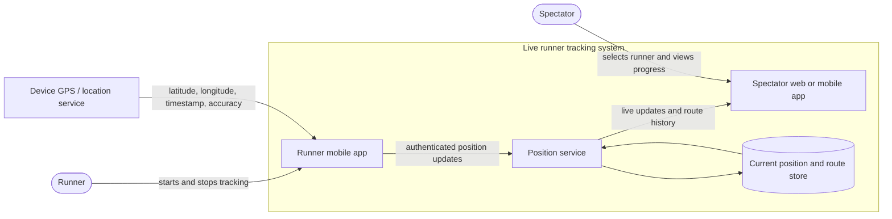
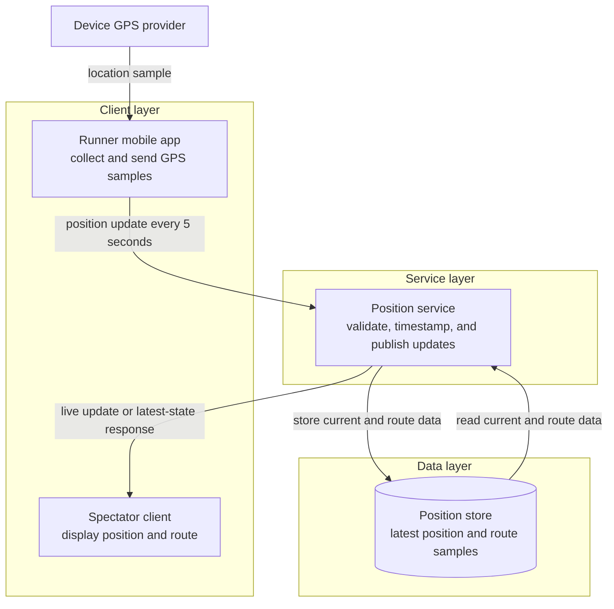
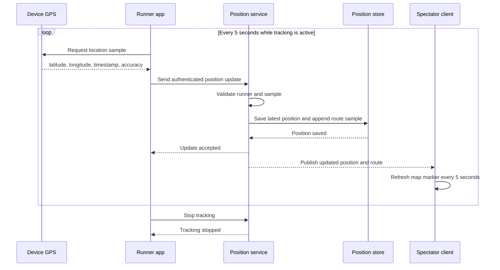

# Design — Live runner tracking architecture

> Epic: #4 · Stories: #29 · Task: #46
> Owner: Jaime Castillo · Sprint 2
> Status: draft

This document describes the planned logical architecture for live runner
tracking. It is intentionally independent of a specific phone framework,
backend language, database, or real-time protocol; those choices are not
made yet by the repository's existing prototype work.

## 1. System context

The system boundary includes the runner application, spectator application,
position service, and position store. The runner's device GPS supplies location
data through its operating-system location API, while spectators use an
application to view the runner's current position and route.

*Figure 1 — System context. The runner, spectator, and device location
provider are external actors; the live position system accepts updates and
provides current position and route information to spectator applications.*

## 2. Architecture

The architecture separates GPS collection and presentation from position
processing and storage. This lets one runner update the system while multiple
spectators receive the same current position data.

*Figure 2 — High-level architecture. The runner client collects GPS samples,
the position service validates and distributes them, and the data layer retains
the current position and route samples needed for spectator updates.*

| Component | Responsibility | Interface |
|---|---|---|
| Runner mobile app | Collect GPS samples from the device, assign them to a live event, and send updates | Position update containing runner, latitude, longitude, timestamp, and accuracy |
| Spectator client | Select a runner and display the latest position and route | Subscribe for live updates or request the latest state every five seconds |
| Position service | Validate an update and distribute it to connected spectators | Authenticated position update API and subscription/query interface |
| Position store | Preserve the latest position and route samples | Current-position lookup and route sample append/read operations |
| Device GPS provider | Produce location data for the runner device | Operating-system location API |

## 3. Live position update sequence

The runner application sends a GPS update every five seconds while tracking is
active. The spectator path can use a real-time subscription or polling of the
latest state; the implementation will choose one of those approaches when the
prototype is designed.

*Figure 3 — Live position update sequence. While an event is being tracked,
the runner client samples GPS data every five seconds, validates and stores
the position, and provides the updated marker or route to spectators.*
