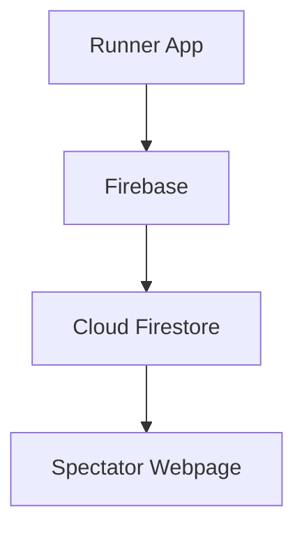

# Marathon Tracker App — Data Model and Flow Design

Epic: #26  
Story: #31  
Task: #47  
Owner: Luis Contreras  
Sprint: 2  
Status: Proposed Design

## Overview

This document describes the proposed design of the Marathon
Tracker App. This includes how GPS data moves through the system,
how runner information is stored, and how users navigate
the application.

The team is currently considering JavaScript and Google
Firebase for development. Firebase may be used to store
runner information, GPS locations, and race posts.

The diagrams in this document represent the planned system
and can be updated as the team finalizes its technology choices.

## 1. Data Flow Diagram

The following diagram shows how GPS coordinates and race
posts move through the proposed Marathon Tracker system.

**Figure 1: Data Flow Diagram for the Marathon Tracker App.**

The runner's application collects GPS coordinates and
allows runners to create race posts. This information
is sent through Firebase services and stored in Cloud
Firestore.

The spectator webpage receives runner location updates
and posts through Firebase, allowing spectators to
follow the runner's progress.

JavaScript and Firebase are currently proposed
technologies and may change as development progresses.

