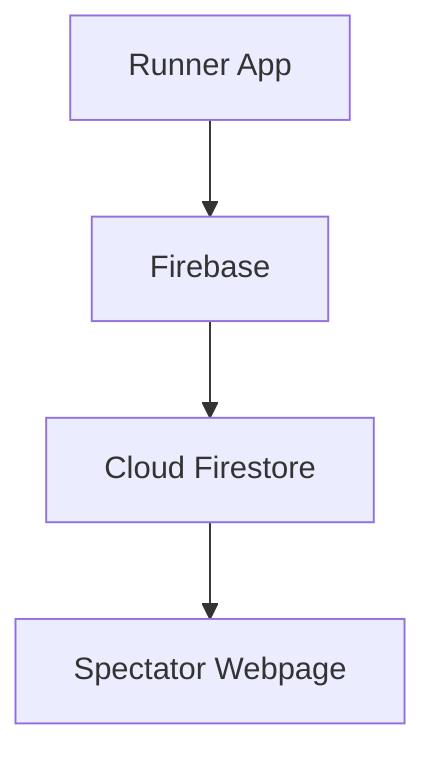
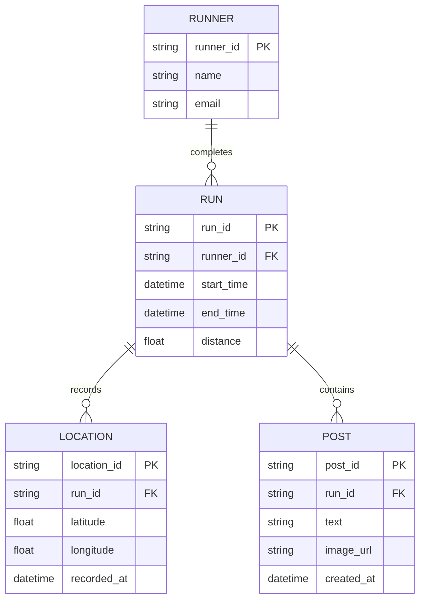
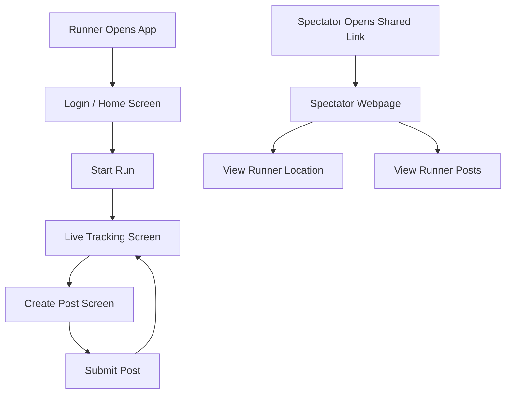

# Marathon Tracker App — Data Model and Flow Design

Epic: #26  
Story: #31  
Task: #47  
Owner: Luis Contreras  
Sprint: 2  
Status: Proposed Design

## Overview

This document describes the proposed design of the Marathon
Tracker App. This includes how GPS data moves through the system,
how runner information is stored, and how users navigate
the application.

The team is currently considering JavaScript and Google
Firebase for development. Firebase may be used to store
runner information, GPS locations, and race posts.

The diagrams in this document represent the planned system
and can be updated as the team finalizes its technology choices.

## 1. Data Flow Diagram

The following diagram shows how GPS coordinates and race
posts move through the proposed Marathon Tracker system.

**Figure 1: Data Flow Diagram for the Marathon Tracker App.**

The runner's application collects GPS coordinates and
allows runners to create race posts. This information
is sent through Firebase services and stored in Cloud
Firestore.

The spectator webpage receives runner location updates
and posts through Firebase, allowing spectators to
follow the runner's progress.

JavaScript and Firebase are currently proposed
technologies and may change as development progresses.

## 2. Entity Relationship Diagram

The following diagram shows how runner information,
running sessions, GPS locations, and posts are related.

**Figure 2: Entity Relationship Diagram for the Marathon Tracker App.**

A runner can complete multiple runs. Each run can contain
multiple GPS location records and multiple posts.

The RUN entity also stores information about previous
runs, allowing runners to review their running history.

These entities represent a proposed data model. If the
team selects Firebase Cloud Firestore, they can be
implemented using documents and collections rather than
traditional SQL tables.

## 3. Screen Flow Diagram

The following diagram shows how runners and spectators
navigate the Marathon Tracker application.

**Figure 3: Screen Flow Diagram for the Marathon Tracker App.**

The runner begins by opening the application and accessing
the home screen. After starting a run, the application
displays live tracking information.

During the run, the runner can create a post containing
a photo and up to 100 characters of text. After submitting
the post, the runner returns to the live tracking screen.

Spectators can open a shared link to view the runner's
location and race posts on a webpage.

The screen flow represents the proposed user experience
and may be updated during implementation.
